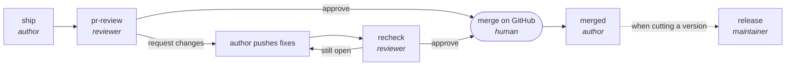
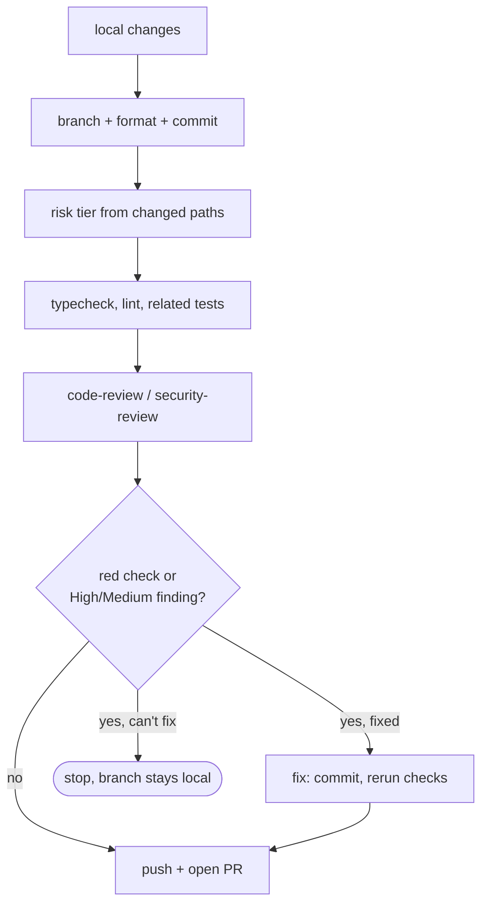
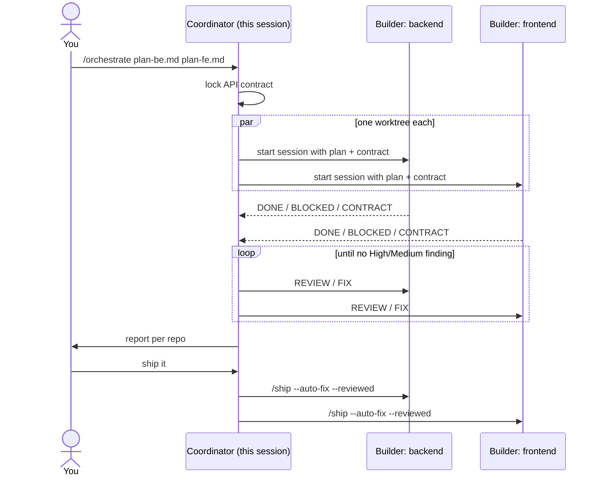

# skills

[](https://github.com/zahidakhyar/skills/actions/workflows/validate.yml)
[](LICENSE)

Agent skills for Claude Code, packaged as a plugin so you and your team work with the same ones. The repo is both the plugin and its marketplace: install it once and every skill in `skills/` comes with it, including ones added later.

- [Install](#install)
- [Skills](#skills)
- [Per-repo configuration](#per-repo-configuration)
- [Requirements](#requirements)
- [Updating](#updating)
- [Troubleshooting](#troubleshooting)
- [Contributing](#contributing)
- [License](#license)

## Install

### For yourself

In Claude Code:

```
/plugin marketplace add zahidakhyar/skills
/plugin install zahidakhyar-skills@zahidakhyar
```

Or from a shell:

```bash
claude plugin marketplace add zahidakhyar/skills
```

```bash
claude plugin install zahidakhyar-skills@zahidakhyar
```

Start a new session afterwards. Check that it loaded:

```bash
claude plugin details zahidakhyar-skills
```

### For a whole project

Commit this to the project's `.claude/settings.json`. Anyone who opens the project in Claude Code is offered the marketplace and the plugin, with no manual step:

```json
{
  "extraKnownMarketplaces": {
    "zahidakhyar": { "source": { "source": "github", "repo": "zahidakhyar/skills" } }
  },
  "enabledPlugins": { "zahidakhyar-skills@zahidakhyar": true }
}
```

### Calling a skill

Plugin skills are namespaced: `/zahidakhyar-skills:ship`, `/zahidakhyar-skills:pr-review`, and so on. A slash command is optional. Claude also picks the right skill from a plain request, in English or Indonesian ("ship ini", "review PR #123", "sudah ku merge, cleanup").

## Skills

| Skill | When to use it |
|---|---|
| [`ship`](#ship) | You have local changes and want a PR |
| [`pr-review`](#pr-review) | A teammate asked you to review their PR |
| [`recheck`](#recheck) | The author pushed fixes after your review |
| [`merged`](#merged) | A PR was merged and the local leftovers need cleaning |
| [`release`](#release) | Cut a new version of a JS/TS project |
| [`orchestrate`](#orchestrate) | Build one or more implementation plans in separate sessions |
| [`learned`](#learned) | Save what this session taught Claude to memory |

The first five form one PR loop:



### ship

Branch → format → commit → gate → push → PR, in one command.

```
/zahidakhyar-skills:ship [base] [--issue N] [--draft] [--auto-fix] [--reviewed]
```

| Flag | Effect |
|---|---|
| `base` | Target branch. Default: `dev`, then `develop`, then the repo's default branch |
| `--issue N` | Adds `Closes #N` when the branch name and commits don't mention an issue. Other repo: `--issue owner/repo#N` |
| `--draft` | Opens the PR as a draft |
| `--auto-fix` | Turns on the desktop app's Auto-fix for the PR, so the session wakes on CI failures, conflicts and review comments. Never enables auto-merge |
| `--reviewed` | Skips the code/security review in the gate (typecheck, lint and tests still run). Used by `orchestrate` |

What the gate does before anything is pushed:

1. Picks a risk tier (Low / Medium / High) from the changed paths. The tier goes into the PR body as a `## Risk` line, and reviewers use it to set review depth.
2. Runs typecheck, lint and the related tests, with commands taken from the repo's `package.json` scripts or CI workflow.
3. Runs `code-review` at the tier's effort, and `security-review` when the diff touches auth, endpoint input, queries, uploads, user HTML or secrets.



Example: `/zahidakhyar-skills:ship dev --issue 42 --auto-fix`

### pr-review

First review of someone else's PR, posted as a single GitHub review (one notification for the author).

```
/zahidakhyar-skills:pr-review <PR number|URL> [--comment]
```

- No PR given → lists PRs where your review is requested and asks which one.
- Checks the PR out in a throwaway worktree under `.worktrees/`, so your working tree is untouched.
- Runs `code-review`, plus `security-review`, a deploy-window check (migrations, cache keys, worker routing) and an `impeccable` UI audit when the diff calls for them.
- Every finding must have a concrete failure scenario and gets a label: **High**, **Medium**, **Low**, **Nit** or **Pre-existing**. Any High/Medium → request changes; otherwise approve.
- Shows you the draft and posts only after you say yes. `--comment` posts without asking.
- Writes a hidden `<!-- reviewed: <sha> -->` marker so `recheck` knows what you already saw.

Running it on a PR you already reviewed points you to `recheck`.

### recheck

Re-review after the author pushed fixes.

```
/zahidakhyar-skills:recheck <PR number|URL>
```

- Reviews only the delta since your last review (found through the `reviewed:` marker). After a force-push it reviews the whole PR again.
- Reads unresolved inline threads, review bodies and issue comments, all paginated.
- Gives each earlier finding a verdict: `FIXED`, `PARTIAL`, `NOT FIXED`, `REBUTTED-VALID` or `REBUTTED-REJECTED`, based on the code at the new head, never on the author's reply.
- Resolves fixed threads, replies under the ones still open, and posts one review with the verdict and any new findings from the fix commits.

### merged

Post-merge cleanup.

```
/zahidakhyar-skills:merged [PR number | branch] [--close-issues] [--dry-run]
```

- Confirms the PR is merged, removes its worktree, switches to the base and pulls, deletes the local and remote branch.
- Asks before touching anything with uncommitted changes.
- GitHub only auto-closes `Closes #N` issues for PRs into the default branch. For a PR into `dev`, the skill reports which issues are still open; `--close-issues` closes them.
- After a hotfix into `main`, checks whether `dev` needs a back-merge.
- Works in a folder with several sub-repos.
- `--dry-run` prints the commands without running them.

### release

Version bump plus release PR for a JS/TS project.

```
/zahidakhyar-skills:release <major|minor|patch>
```

- Requires a clean tree and a `package.json`. No argument → shows the current version and asks.
- Bumps with `npm version --no-git-tag-version` (safe with yarn/pnpm), updates `CHANGELOG.md` if the repo has one, creates an annotated tag, and pushes branch and tag together.
- Opens a `release: vX.Y.Z` PR with a body built from the commits since the last tag.
- Merge it with "Create a merge commit", not squash; squash leaves the tag outside the target branch's history.
- After the merge, tell Claude the release PR is merged and it creates the GitHub release from the tag.

### orchestrate

Builds implementation plans in separate builder sessions while the current session coordinates. Made for cross-repo work (backend + frontend) where both sides must agree on one API contract.

```
/zahidakhyar-skills:orchestrate [plan path ...] [--contract <path>] [--opus]
```

- No path → the newest file in `docs/superpowers/plans/`.
- Two or more repos → locks a shared contract first, or uses `--contract <path>`.
- One builder session per plan, each in its own worktree. Builders run on Sonnet by default; the coordinator suggests Opus per plan where it pays off, and `--opus` puts every builder on Opus.
- When builders finish, runs a review-fix loop per repo and a combined cross-repo check, then has each builder `ship` its own PR when you say so.



Works only in the Claude desktop app's Code tab, which provides the session tools.

### learned

Turns corrections, confirmed choices and project decisions from the session into memory files Claude reads next time.

```
/zahidakhyar-skills:learned
/zahidakhyar-skills:learned consolidate
```

- Writes one fact per file to the project's memory directory and updates the `MEMORY.md` index. Updates an existing memory instead of adding a duplicate.
- Skips what the code, git history or CLAUDE.md already say.
- Also triggers by itself after a correction or "remember this" / "catat ini".
- `consolidate` merges duplicates and prunes stale memories via `anthropic-skills:consolidate-memory`.

## Per-repo configuration

The skills read their conventions from the repo they run in. None of these files are required.

| File / convention | Read by | Effect |
|---|---|---|
| `REVIEW.md` at the repo root | `pr-review`, `recheck` | Overrides the [default review protocol](skills/pr-review/references/review-protocol.md): severity definitions, Nit limit, review language, areas whose bugs are always High. Read from the PR's base branch, so a PR cannot change its own rules |
| `CLAUDE.md` / `AGENTS.md` | `pr-review`, `recheck` | Project rules that findings and author rebuttals are checked against |
| `## Risk` line in the PR body | `pr-review` | Sets review depth. `ship` writes it; for PRs opened without it, the tier is derived from the changed files |
| `package.json` scripts, `.github/workflows/*.yml` | `ship`, `pr-review`, `recheck` | Source of the typecheck, lint and test commands. A green CI check that already runs them is cited instead of re-run |
| `dev` / `develop` branch | `ship`, `orchestrate` | Default PR target when present |
| `CHANGELOG.md` | `release` | Updated on each release when present |

## Requirements

- Claude Code with plugin support.
- `git`, `gh` (logged in with `gh auth login`) and `jq` on the PATH.

Optional plugins. The skills skip the step when the plugin is missing:

| Plugin | Used by | For |
|---|---|---|
| `humanizer` | `pr-review`, `release` | Rewriting review and PR prose so it reads naturally |
| `impeccable` | `pr-review` | UI audit on frontend diffs |
| `superpowers` | `orchestrate` | Plan execution inside builder sessions |
| `anthropic-skills` | `learned` | `/learned consolidate` |

`code-review` and `security-review` are built into Claude Code.

## Updating

```bash
claude plugin marketplace update zahidakhyar
```

Installed copies are cached per version (`~/.claude/plugins/cache/<marketplace>/<plugin>/<version>/`), so a change reaches users only after the maintainer bumps `version` in `.claude-plugin/plugin.json`. Release notes are in [CHANGELOG.md](CHANGELOG.md).

## Troubleshooting

| Symptom | Fix |
|---|---|
| `/zahidakhyar-skills:ship` is not recognised | Start a new session after installing; check `claude plugin details zahidakhyar-skills` |
| Every skill shows up twice | The skills are loaded from both the plugin and `~/.claude/skills/`. Keep only one (see [local setup](CONTRIBUTING.md#local-setup)) |
| A change on `main` doesn't arrive | Check that `version` was bumped, then run `claude plugin marketplace update zahidakhyar` |
| `gh: command not found` / `HTTP 401` | Install `gh` and run `gh auth login` |
| `orchestrate` can't start sessions | It needs the Claude desktop app's Code tab |

## Contributing

Bug reports, fixes and new skills are welcome. See [CONTRIBUTING.md](CONTRIBUTING.md) for local setup, how to write a skill, and the checks CI runs. Report security problems through [SECURITY.md](SECURITY.md).

## License

[MIT](LICENSE)
